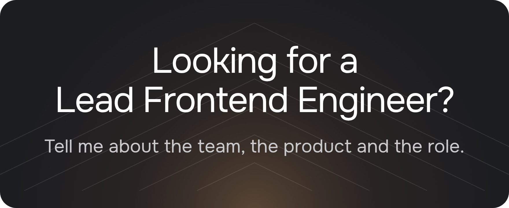
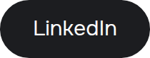
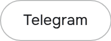

## About

Lead Frontend Engineer with 10 years building and owning production web applications.

For the past 4 years I've been the sole technical owner of the client side at HEXN, a cryptocurrency platform - an exchange, a content & analytics product (blog, news, market data), an affiliate site, and a Telegram Mini App.

Key results:

- Mobile PageSpeed: 90+
- Organic clicks: 27x growth in 6 months
- Created a UI kit of 67 components from scratch, in Storybook
- Engineered LLM pipelines generating 2,000+ market articles and 450 forecasts from 1,000+ crypto and stock assets (Strapi, Hono/PostgreSQL)
- Automated translation of the content catalog and 1,100 i18n keys across 11 locales via an n8n + LLM pipeline
- Integrated TradingView charts with a custom datafeed for real-time trading interfaces
- Architected a yarn workspaces monorepo of 17 internal packages (UI kit, i18n, storage, HTTP client, logging, error handling) shared across 3 production apps

Frontend: React, Next.js, TypeScript\
Backend: Node.js\
Web3: EVM and TON wallet integrations, SIWE auth\
AI: LLM, OpenAI/GPT, Anthropic/Claude, RAG, embeddings, prompt engineering, n8n

Previously led 2 frontend engineers, migrated a legacy platform to Next.js, and built a drag-and-drop trading terminal.

<a href="https://linkedin.com/in/avi2dg"><picture><source media="(prefers-color-scheme: dark)" srcset="assets/pill-linkedin-dark.png"></picture></a>
<a href="https://t.me/avi2d"><picture><source media="(prefers-color-scheme: dark)" srcset="assets/pill-telegram-dark.png"></picture></a>

